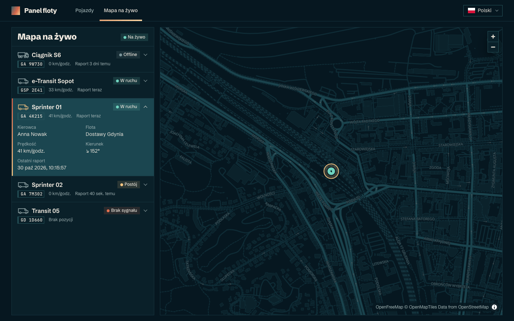
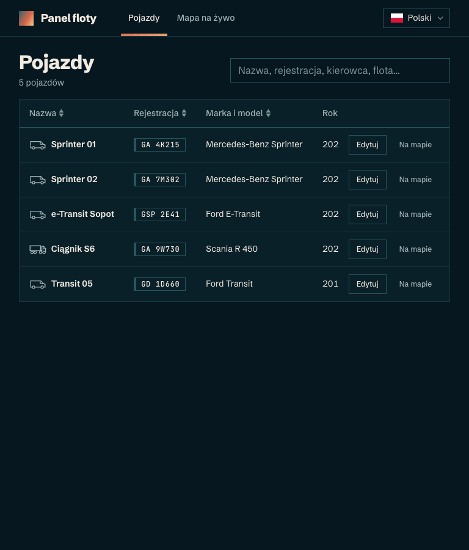
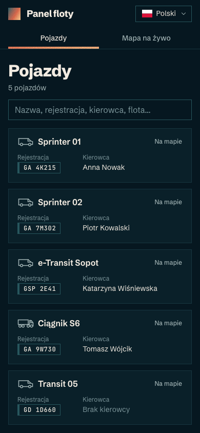

# Fleet Panel

A small app for a vehicle fleet dispatcher, working against the Fleet API (REST + SignalR):

- **Vehicles** – a sortable, searchable table of every vehicle. Editing happens in a modal dialog.
  On phones, tapping a compact card opens the same dialog read-only, with Edit in its header.
- **Live map** – a list of vehicles next to a MapLibre map where they move live (SignalR). The list
  and the map share one selected vehicle, and the map zooms in on it and follows it. Dragging the map stops following
  until a vehicle is selected again.

The UI is Polish by default, with English in a language dropdown. Everything else (code, comments, this file) is in English.

| Live map (1440 px) | Vehicles (768 px) | Vehicles (390 px) |
| --- | --- | --- |
|  |  |  |

## Getting started

Requires **Node.js 22+** and the Fleet API running on **http://localhost:4000** (REST and the
SignalR hub at `/tracking`).

```bash
npm install
npm run dev   # http://localhost:5173
```

The API address can be changed with `VITE_API_BASE_URL` (see `.env.example`).

## Scripts

| Command | What it does |
| --- | --- |
| `npm run dev` | Dev server with HMR |
| `npm run build` / `npm run preview` | Type-check + production build / serve the build |
| `npm run typecheck` | TypeScript project references (app, tooling, e2e) |
| `npm run lint` | ESLint, including Prettier and the Feature-Sliced Design import rules |
| `npm run format` / `format:check` | Prettier write / check |
| `npm test` / `npm run test:run` | Vitest in watch mode / once |
| `npm run test:coverage` | Vitest with a v8 coverage report and thresholds |
| `npm run test:e2e` | Playwright functional tests (1440 px desktop + 390 px mobile) |
| `npm run test:visual` | Playwright visual regression at 390, 768, 1024, 1280, 1440, 1920 and 2560 px, in Docker |
| `npm run test:visual:update` | Re-record the visual baselines after an intended UI change |
| `npm run screenshots` | Re-take the README screenshots in `docs/screenshots/` (mocked API, real OpenFreeMap tiles) |
| `npm run check` | Everything above: lint, format check, type-check, Vitest with coverage, e2e and visual tests |

The first Playwright run needs a browser: `npx playwright install chromium`.

`npm install` enables a pre-commit hook (`.githooks/pre-commit`) that runs `npm run check` on the staged
files, so a commit goes through only when every check passes. It takes a few minutes and needs Docker.
Skip it once with `git commit --no-verify`.

## Tests

**Unit and component tests (Vitest + Testing Library, jsdom)** live next to the code (`*.test.ts(x)`):
274 tests, about 92% statement coverage. They cover:

- pure logic: validation, API error mapping, status, interpolation, URL state, formatting, basemap
  colours, camera follow;
- every component's states, asserted the way a user sees them (roles, labels, Polish copy);
- keyboard and mouse use of the language dropdown;
- motion that gates behaviour: the dialog and toast exit animations, collapsing map list cards, the
  loading screen's minimum duration;
- the real route tree: the dialog's modes, Back after closing, page titles;
- failed background refreshes and live reconnects.

The network is faked at the `fetch` level, so the real API client and error parsing run in every
test. SignalR is a fake hub connection driven by the tests. MapLibre needs WebGL, so jsdom tests swap
the map for buttons that fire the same events; Playwright covers the real map.

**Playwright** runs against a production build (`vite build --mode e2e`) with the whole API played
in the browser by `e2e/support/mockApi.ts`: REST and the SignalR negotiate call via `page.route`, the
hub WebSocket via `page.routeWebSocket`, and a local tile-less map style. The clock is fixed and
reduced motion is on, so runs are deterministic and screenshots stable.

- **Functional specs** (`*.e2e.ts`): the loading screen, sorting and search in the URL, the whole
  edit flow (server errors, retry, Esc, deep link, focus, Back), live updates, selection in both
  directions, following a vehicle (paused by a drag), the map list, "Show on map", the saved
  language and the mobile reduced mode.
- **Visual specs** (`*.visual.ts`): the table (plus empty and error states), the edit dialog (plus
  errors), the details dialog, the map with a selection, and one English check.

Visual tests run only in the official `mcr.microsoft.com/playwright` image (Docker must be running),
because font rendering differs between systems. One set of baselines then works on macOS, Linux,
Windows and in CI.

## Architecture

[Feature-Sliced Design](https://feature-sliced.design). Layers import only from layers below them,
and slices only through their `index.ts`. ESLint enforces both (`no-restricted-imports` per layer,
no extra plugin).

```
src/
  app/       entry point, providers, route tree, layout, global styles and design tokens
  pages/     vehicles (table + dialog outlet), vehicle-dialog (details and edit), live-map, errors
  widgets/   vehicles-table, vehicle-map, tracking-list, app-header
  features/  edit-vehicle, live-tracking, select-vehicle, switch-language
  entities/  vehicle (incl. dictionaries), driver, fleet, vehicle-position
  shared/    api client, config, i18n, lib, ui kit, test helpers
```

## Decisions

### Technical

- **Stack**: Vite, React 19 with the React Compiler, TanStack Router, Query, Table and Form, Zustand,
  MapLibre (`react-map-gl`), `@microsoft/signalr` and i18next. No zod, MSW or CSS framework:
  hand-written validators, a `fetch` stub and Playwright routing are enough.
- **Server state in TanStack Query, client state in Zustand.** Route loaders only start fetching, so
  navigation stays instant; pages show their own loading, error and empty states. A failed
  background refresh keeps the data on screen.
- **Table state in the URL** (`?q=…&sort=-name`), so it survives the dialog, reloads and shared
  links. Search ignores case, spaces and Polish diacritics.
- **The route drives the vehicle dialog**: `/vehicles/$id` shows details, `/vehicles/$id/edit`
  edits, and switching keeps the dialog open. Closing replaces the history entry, so Back does not
  reopen it. The native `<dialog>` gives the focus trap and Esc.
- **Validation mirrors the API** (including a unique plate and a model of the chosen make). Fields
  validate on Save, then as you type; API errors show on their fields.
- **Save waits for the server** and keeps the edits after a failure.
- **Live tracking only on the map page.** It resubscribes after every reconnect and turns live only
  once that succeeds. Out-of-order positions are ignored.
- **The map page is lazy-loaded**, because MapLibre is ~1.1 MB.
- **i18n with type-checked keys**; tests keep every locale's keys and plural forms in sync. A new
  language is a locale file, a flag SVG and one entry in `shared/i18n/languages.ts`.
- **Accessibility basics**: landmarks, labelled fields with linked errors, `aria-sort`, and live
  regions for status, counts and toasts.

### Design

- **Four-colour palette** (sand, ember, teal, abyss) on a flat deep-teal background, dark only, with
  sharp corners. Tokens live in `src/app/styles/tokens.css`.
- **Grainy gradient for accents only**: the logo, the primary button, the active tab and the
  dialog's top edge.
- **A map that belongs to the app**: the OpenFreeMap *dark* style, repainted on load in the app
  palette.
- **Vehicle details at a glance**: registration numbers look like small number plates, and each name
  starts with a line icon of its type (car, van, small truck, tractor-trailer; dashed if unknown).
- **Motion with a purpose**: the dialog and toasts fade and slide in and out, markers glide between
  reports, and the vehicle list opens with a short loading animation (a vehicle driving a route, at
  least 2.2 s so it is not cut off). Reduced motion turns all of it off.
- **Self-hosted fonts** (Schibsted Grotesk, JetBrains Mono for plates), so the app and the
  screenshots do not depend on system fonts or a CDN.
- **Mobile below 768 px is a reduced mode**: tappable vehicle cards (name, plate, driver), a
  full-screen dialog and a compact map list. No sorting.
- **A custom language dropdown with flags**, so it scales past two languages.

## Assumptions

- A vehicle is **offline** after **5 minutes** without a report (parked vehicles report every 60 s),
  otherwise *moving* or *parked*. Without any report it has *no signal* and is not on the map.
- The live connection is needed only on the map page; the table shows no live status.
- No vehicle labels on the map: the list shows the names, and screenshots stay stable.
- API data (fleet, driver and model names) is not translated; only the UI and enum values are.
- Long API text is cut with an ellipsis and shown in full in a tooltip: the API allows longer values
  (a 60-character name, a 50-character plate) than a readable table can show.
- "Show on map" connects the two views; the task does not require it.
- Vehicles cannot be created or deleted: the API has no `POST` or `DELETE` for them.

## What next

- Live status (and last report) as a column in the vehicle table.
- An unsaved-changes guard when closing the dialog with edits (TanStack Router `useBlocker`).
- Filters by status and fleet on the map list; clustering if the fleet grows.
- Automated accessibility checks (axe) in the Playwright suite.
- CI: lint, type-check, Vitest and Playwright in the Playwright Docker image (the visual tests already run there).
- An optimistic save (with rollback) if the real API turns out to be slow.
- Translated MapLibre control tooltips.
