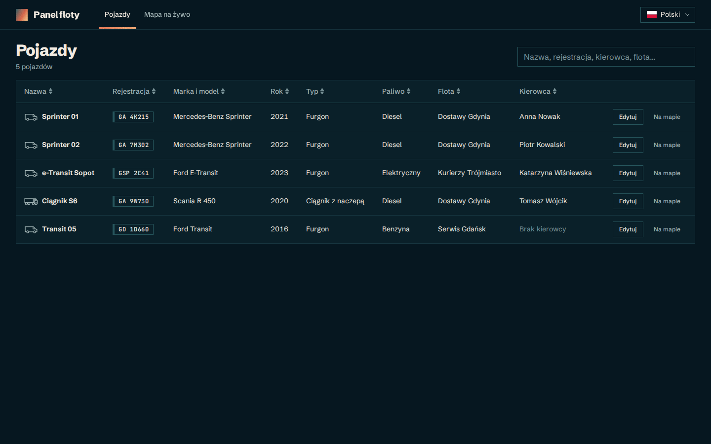
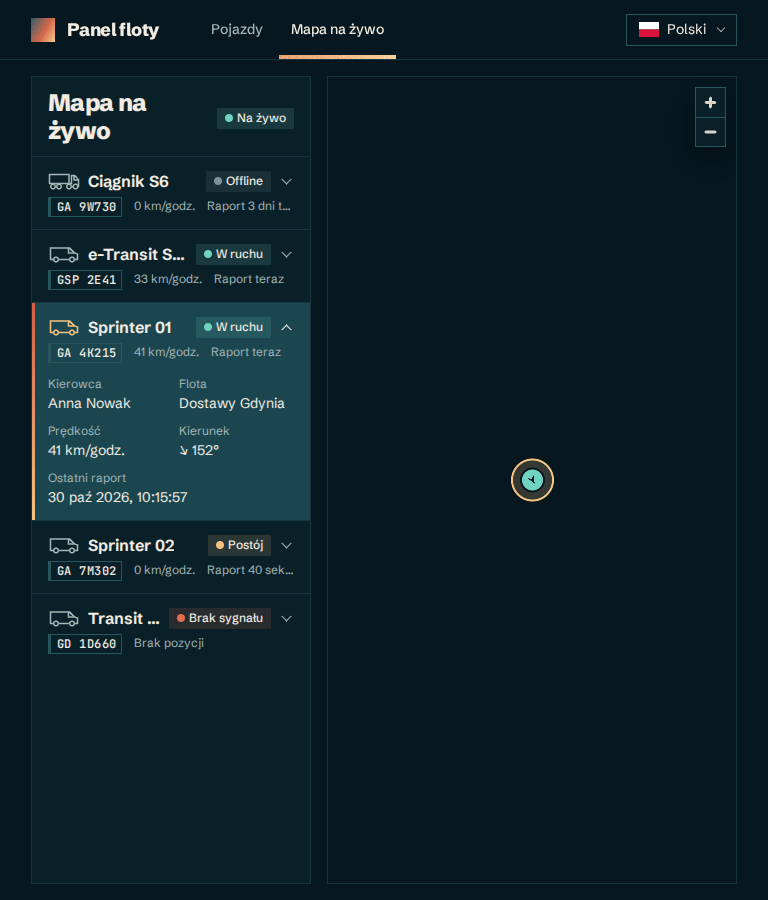
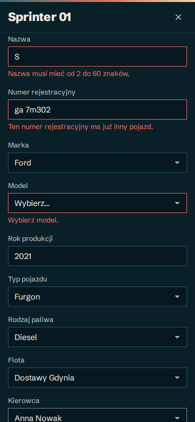

# Fleet Panel

A small app for a vehicle fleet dispatcher, working against the Fleet API (REST + SignalR):

- **Vehicles** – a sortable, searchable table of every vehicle. Editing happens in a modal dialog.
  On phones, tapping a compact card opens the same dialog read-only, with Edit in its header.
- **Live map** – a list of vehicles next to a MapLibre map where they move live (SignalR). The list
  and the map share one selected vehicle, and the map zooms in on it and follows it. Dragging the map stops following
  until a vehicle is selected again.

The UI is Polish by default, with English in a language dropdown. Everything else (code, comments, this file) is in English.

| Vehicles (1440 px) | Live map (768 px) | Mobile (390 px) |
| --- | --- | --- |
|  |  |  |

## Getting started

Requires **Node.js 22+** and the Fleet API running on **http://localhost:4000** (REST and the
SignalR hub at `/tracking`).

```bash
npm install
npm run dev   # http://localhost:5173
```

The API address can be changed with `VITE_API_BASE_URL` (see `.env.example`).

## Scripts

| Command | What it does |
| --- | --- |
| `npm run dev` | Dev server with HMR |
| `npm run build` / `npm run preview` | Type-check + production build / serve the build |
| `npm run typecheck` | TypeScript project references (app, tooling, e2e) |
| `npm run lint` | ESLint, including Prettier and the Feature-Sliced Design import rules |
| `npm run format` / `format:check` | Prettier write / check |
| `npm test` / `npm run test:run` | Vitest in watch mode / once |
| `npm run test:coverage` | Vitest with a v8 coverage report and thresholds |
| `npm run test:e2e` | Playwright functional tests (1440 px desktop + 390 px mobile) |
| `npm run test:visual` | Playwright visual regression at 390, 768, 1024, 1280, 1440, 1920 and 2560 px, in Docker |
| `npm run test:visual:update` | Re-record the visual baselines after an intended UI change |
| `npm run check` | Everything above: lint, format check, type-check, Vitest with coverage, e2e and visual tests |

The first Playwright run needs a browser: `npx playwright install chromium`.

`npm install` enables a pre-commit hook (`.githooks/pre-commit`) that runs `npm run check` on the staged
files, so a commit goes through only when every check passes. It takes a few minutes and needs Docker.
Skip it once with `git commit --no-verify`.

## Tests

**Unit and component tests (Vitest + Testing Library, jsdom)** live next to the code (`*.test.ts(x)`):
274 tests, about 92% statement coverage. They cover:

- pure logic: validation rules, mapping API messages, status, interpolation, URL state, formatting,
  repainting the basemap in the app palette, moving the camera with a followed vehicle;
- every component's states, assertions written the way a user sees the UI (roles, labels, Polish copy),
  including the vehicle type icon in the accessible name of table rows and map list items;
- keyboard and mouse use of custom widgets (the language dropdown);
- motion that gates behaviour: the dialog and toasts close only after their exit animation, the
  map list keeps a card's details until it has collapsed (jsdom runs no animations, so tests
  hold one open by hand), and the vehicle list's loading screen stays for its full duration
  (fake timers);
- integration through the real route tree (`src/app/test/renderApp.tsx`), including the vehicle
  dialog switching between details and edit without closing, not reopening on Back, and the page
  and dialog titles;
- failed background refreshes: the table and an open edit form keep their data and edits;
- the reconnect path of the live connection (status turns live only after a new subscription).

The network is faked at the `fetch` level (`src/shared/test/fetchStub.ts`), so the real API client
and error parsing run in every test. SignalR is replaced by a fake hub connection that tests drive
by hand. MapLibre needs WebGL, so jsdom tests swap the map for buttons that fire the same click
events. The real map is covered by Playwright.

**Playwright** runs against a production build (`vite build --mode e2e`). Its API address
(`http://fleet-api.test`, see `.env.e2e`) does not exist; `e2e/support/mockApi.ts` plays the whole
API in the browser:

- REST endpoints and the SignalR negotiate call through `page.route`;
- the hub WebSocket through `page.routeWebSocket` (JSON hub protocol handshake, the
  `SubscribeLiveTrack` reply, `LiveTrack` pushes);
- map tiles through a local, tile-less style.

The clock is fixed and reduced motion is on, so runs are deterministic and screenshots stable.

- **Functional specs** (`*.e2e.ts`) cover:
  - the loading screen with motion on, then the table;
  - sorting and searching in the URL, and the header link clearing the search;
  - the whole edit flow: PUT body, server 400 errors on fields, 500 then retry, Esc, deep link,
    focus trapped and restored, Back not reopening a closed dialog;
  - live updates;
  - selection in both directions (a fixture vehicle stands in the middle of the map, so a click on
    the canvas centre selects it);
  - the map following the selected vehicle as it moves, pausing after a drag and resuming on a
    click on its marker (a vehicle under the canvas centre shows the pointer cursor);
  - the list's details expanding into view and collapsing on a click;
  - "Show on map";
  - the language persisting across reloads;
  - the mobile reduced mode: compact cards with a truncated name, details from a tapped card, edit
    and back (also with the browser's Back), "Show on map" and the map list.
- **Visual specs** (`*.visual.ts`) cover:
  - the table, plus its empty and error states;
  - the edit dialog, plus a version with errors, and the read-only details dialog;
  - the map with a selection;
  - one English check.

Visual tests run only in the official `mcr.microsoft.com/playwright` image (Docker must be running),
because font rendering differs between systems. One set of baselines then works on macOS, Linux,
Windows and in CI.

## Architecture

[Feature-Sliced Design](https://feature-sliced.design). Layers import only from layers below them,
and slices only through their `index.ts`. ESLint enforces both (`no-restricted-imports` per layer,
no extra plugin).

```
src/
  app/       entry point, providers, route tree, layout, global styles and design tokens
  pages/     vehicles (table + dialog outlet), vehicle-dialog (details and edit), live-map, errors
  widgets/   vehicles-table, vehicle-map, tracking-list, app-header
  features/  edit-vehicle, live-tracking, select-vehicle, switch-language
  entities/  vehicle (incl. dictionaries), driver, fleet, vehicle-position
  shared/    api client, config, i18n, lib, ui kit, test helpers
```

## Decisions

- **Stack from [docs/STACK.md](docs/STACK.md)**, plus `react-map-gl`, `@microsoft/signalr`, i18next, Playwright and
  Prettier. No zod, MSW or CSS framework: hand-written validators, a `fetch` stub and Playwright
  routing are enough.
- **Server state in TanStack Query, client state in Zustand** (selected vehicle, live positions,
  toasts). Route loaders only start fetching, so navigation stays instant on a slow API; pages show
  their own loading, error (with Retry) and empty states. A failed background refresh keeps the
  data on screen.
- **Table state in the URL** (`?q=…&sort=-name`): it survives the dialog, reloads and shared links.
  Search ignores case, spaces and Polish diacritics.
- **Vehicle dialog driven by the route**: `/vehicles/$id` shows details (the form locked),
  `/vehicles/$id/edit` edits. Switching modes keeps the dialog open; Save and Cancel after Edit from
  details go back to details. Closing replaces the history entry, so Back does not reopen it. Built on the native `<dialog>` for the focus trap and Esc. It does not close on a backdrop click or while saving. It fades and slides in
  and out (not with reduced motion); the route changes only after the exit animation. Toasts
  animate the same way.
- **Validation mirrors the API**: the same rules, including a unique plate and a model that belongs
  to the make. Fields validate on Save, then live as you type (errors shown on blur moved the Save
  button mid-click). API errors are mapped to translation keys and shown on their fields.
- **Save waits for the server**: the UI waits for the response, and after a failure it keeps the
  edits so the user can retry.
- **Live tracking only on the map page**, with automatic reconnect and a new subscription after
  each reconnect, because a subscription belongs to its connection. The status turns live only
  once that subscription succeeds. Out-of-order positions are ignored.
- **Smooth markers**: each one moves between consecutive reports over the time between them,
  drawn straight into the MapLibre source; with reduced motion they jump instead.
- **Dark map style** (OpenFreeMap *dark*, not *liberty*), repainted on load in the app palette, so
  the map looks like part of the app. The map page is a lazy-loaded chunk, because MapLibre is ~1.1 MB.
- **i18n with i18next**: Polish by default, type-checked keys, and tests that keep every locale's
  keys and plural forms in sync. A new language is a locale file, a flag SVG and one entry in
  `shared/i18n/languages.ts`. The switcher is a custom, keyboard-accessible dropdown with flags, so
  it scales past two languages.
- **CSS Modules + design tokens** (`src/app/styles/tokens.css`).
- **Design direction**: a flat deep-teal background with a four-colour palette (sand, ember, teal,
  abyss). The grainy gradient (SVG noise) is kept for a few accents: the logo, the primary button, the
  active tab and the dialog's top edge. All corners are sharp. Registration numbers look like small
  number plates. Each vehicle name, in the table and the map list, starts with a line icon of its
  type (car, van, small truck, tractor-trailer; a dashed outline for unknown).
- **Loading screen** for the vehicle list: a vehicle drives a short route while the trail is drawn,
  and the heading and search appear only with the data. On the first load it stays until the vehicle arrives (2.2 s) even when
  the data is faster, so the animation is not cut off mid-route; with reduced motion it waits only for the data.
- **Self-hosted fonts** (Schibsted Grotesk for the UI, JetBrains Mono for plates), so the app
  and the screenshots do not depend on system fonts or a font CDN.
- **Mobile below 768 px is a reduced mode**: compact, tappable vehicle cards (name, plate,
  driver) with "Show on map" next to the name, a full-screen dialog, and the map with a compact list. No sorting or detail panels.
- **Accessibility basics**: landmarks, labelled fields with linked error messages, `aria-sort`,
  and live regions for status, counts and toasts.

## Assumptions

- A vehicle is **offline** when its last report is over **5 minutes** old (parked vehicles report
  every 60 s). Otherwise it is *moving* (speed > 0) or *parked*. Without any report it has *no
  signal* and is not on the map.
- The live connection is needed only on the map page; the table does not show live status.
- No vehicle labels on the map: names are in the list, and the map stays free of glyphs, which keeps
  screenshots stable.
- Data from the API (fleet, driver and model names) is not translated; only the UI and the
  enum values (vehicle and fuel types) are.
- API text in the table (name, plate, make and model, fleet, driver) is cut with an ellipsis at a
  per-column width sized for realistic values, with the full text in a tooltip. The API allows
  longer values (a 60-character name, a 50-character plate) than a readable table can show.
  The map list cuts the same values the same way, at the list's width.
- "Show on map" was added to connect the two views. It is not required by the task.
- Vehicles cannot be created or deleted: the API has no `POST` or `DELETE` for vehicles, and the
  task asks only for editing.

## What next

- Live status (and last report) as a column in the vehicle table.
- An unsaved-changes guard when closing the dialog with edits (TanStack Router `useBlocker`).
- Filters by status and fleet on the map list; clustering if the fleet grows.
- Automated accessibility checks (axe) in the Playwright suite.
- CI: lint, type-check, Vitest and Playwright in the Playwright Docker image (the visual tests already run there).
- An optimistic save (with rollback) if the real API turns out to be slow.
- Translated MapLibre control tooltips.
