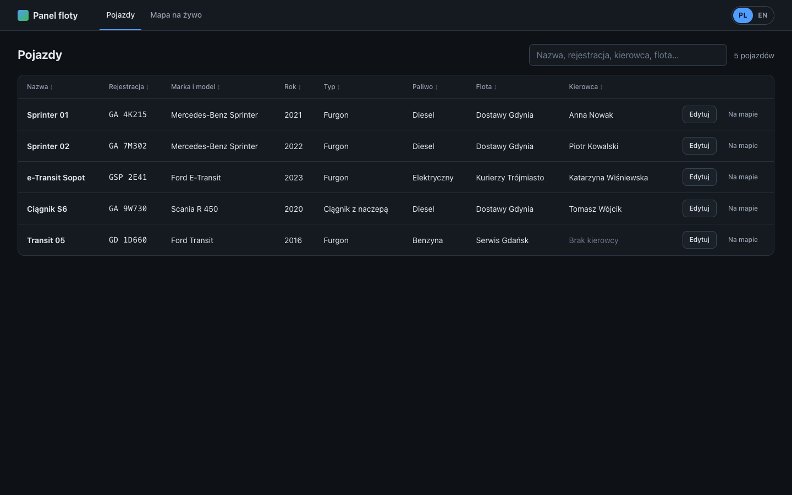
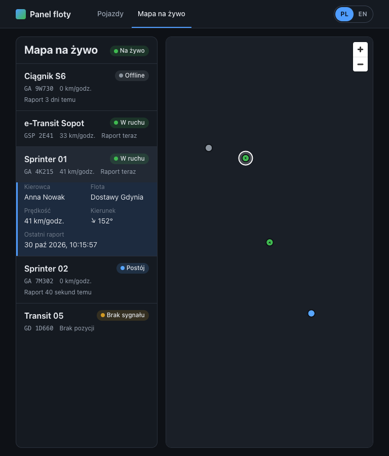
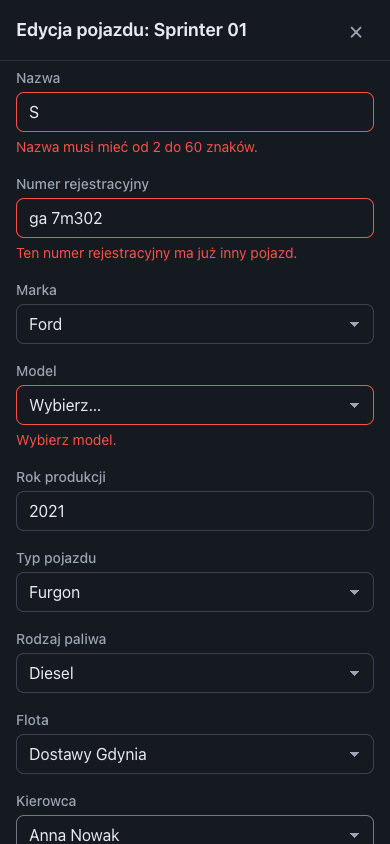

# Fleet Panel

A small app for a vehicle fleet dispatcher, working against the Fleet API (REST + SignalR):

- **Vehicles** – a sortable, searchable table of every vehicle. Editing happens in a modal dialog.
- **Live map** – a list of vehicles next to a MapLibre map where they move live (SignalR). The list
  and the map share one selected vehicle.

The UI is Polish by default, with an English switch. Everything else (code, comments, this file) is in English.

| Vehicles (1440 px) | Live map (768 px) | Mobile (390 px) |
| --- | --- | --- |
|  |  |  |

## Getting started

Requires **Node.js 22+** and the Fleet API running on **http://localhost:4000** (REST and the
SignalR hub at `/tracking`).

```bash
npm install
npm run dev   # http://localhost:5173
```

The API address can be changed with `VITE_API_BASE_URL` (see `.env.example`).

## Scripts

| Command | What it does |
| --- | --- |
| `npm run dev` | Dev server with HMR |
| `npm run build` / `npm run preview` | Type-check + production build / serve the build |
| `npm run typecheck` | TypeScript project references (app, tooling, e2e) |
| `npm run lint` | ESLint, including Prettier and the Feature-Sliced Design import rules |
| `npm run format` / `format:check` | Prettier write / check |
| `npm test` / `npm run test:run` | Vitest in watch mode / once |
| `npm run test:coverage` | Vitest with a v8 coverage report and thresholds |
| `npm run test:e2e` | Playwright functional tests (1440 px desktop + 390 px mobile) |
| `npm run test:visual` | Playwright visual regression at 390, 768, 1024, 1280, 1440, 1920 and 2560 px |
| `npm run test:visual:update` | Re-record the visual baselines after an intended UI change |

The first Playwright run needs a browser: `npx playwright install chromium`.

## Tests

**Unit and component tests (Vitest + Testing Library, jsdom)** live next to the code (`*.test.ts(x)`):
199 tests, about 90% statement coverage. They cover:

- pure logic: validation rules, mapping API messages, status, interpolation, URL state, formatting;
- every component's states, assertions written the way a user sees the UI (roles, labels, Polish copy);
- integration through the real route tree (`src/app/test/renderApp.tsx`).

The network is faked at the `fetch` level (`src/shared/test/fetchStub.ts`), so the real API client
and error parsing run in every test. SignalR is replaced by a fake hub connection that tests drive
by hand. MapLibre needs WebGL, so jsdom tests swap the map for buttons that fire the same click
events. The real map is covered by Playwright.

**Playwright** runs against a production build (`vite build --mode e2e`). Its API address
(`http://fleet-api.test`, see `.env.e2e`) does not exist; `e2e/support/mockApi.ts` plays the whole
API in the browser:

- REST endpoints and the SignalR negotiate call through `page.route`;
- the hub WebSocket through `page.routeWebSocket` (JSON hub protocol handshake, the
  `SubscribeLiveTrack` reply, `LiveTrack` pushes);
- map tiles through a local, tile-less style.

The clock is fixed and reduced motion is on, so runs are deterministic and screenshots stable.

- **Functional specs** (`*.e2e.ts`) cover:
  - sorting and searching in the URL;
  - the whole edit flow: PUT body, server 400 errors on fields, 500 then retry, Esc, deep link,
    focus trapped and restored;
  - live updates;
  - selection in both directions (a fixture vehicle stands in the middle of the map, so a click on
    the canvas centre selects it);
  - "Show on map";
  - the language persisting across reloads;
  - a mobile emergency smoke test.
- **Visual specs** (`*.visual.ts`) cover:
  - the table, plus its empty and error states;
  - the edit dialog, plus a version with errors;
  - the map with a selection;
  - one English check.

Baselines are per platform (`*-darwin.png` were recorded on macOS). Font rendering differs on Linux,
so CI should record its own (`*-linux.png`) in the official `mcr.microsoft.com/playwright` image.

## Architecture

[Feature-Sliced Design](https://feature-sliced.design). Layers import only from layers below them,
and slices only through their `index.ts`. ESLint enforces both (`no-restricted-imports` per layer,
no extra plugin).

```
src/
  app/       entry point, providers, route tree, layout, global styles and design tokens
  pages/     vehicles (table + dialog outlet), vehicle-edit (the dialog), live-map, errors
  widgets/   vehicles-table, vehicle-map, tracking-list, app-header
  features/  edit-vehicle, live-tracking, select-vehicle, switch-language
  entities/  vehicle (incl. dictionaries), driver, fleet, vehicle-position
  shared/    api client, config, i18n, lib, ui kit, test helpers
```

## Decisions

- **Stack from STACK.md**, plus `react-map-gl`, `@microsoft/signalr`, i18next, Playwright and
  Prettier. No zod, MSW or CSS framework: hand-written validators, a `fetch` stub and Playwright
  routing are enough.
- **Server state in TanStack Query, client state in Zustand** (selected vehicle, live positions,
  toasts). Route loaders only start fetching, so navigation stays instant on a slow API; pages show
  their own loading, error (with Retry) and empty states.
- **Table state in the URL** (`?q=…&sort=-name`): it survives the dialog, reloads and shared links.
  Search ignores case, spaces and Polish diacritics.
- **Edit dialog driven by the route** (`/vehicles/$id/edit`), built on the native `<dialog>` for the
  focus trap and Esc. It does not close on a backdrop click or while saving.
- **Validation mirrors the API**: the same rules, including a unique plate and a model that belongs
  to the make. Fields validate on Save, then live as you type (errors shown on blur moved the Save
  button mid-click). API errors are mapped to translation keys and shown on their fields.
- **Save waits for the server**: the UI waits for the response, and after a failure it keeps the
  edits so the user can retry.
- **Live tracking only on the map page**, with automatic reconnect and a new subscription after
  each reconnect, because a subscription belongs to its connection. Out-of-order positions are
  ignored.
- **Smooth markers**: each one moves between consecutive reports over the time between them,
  drawn straight into the MapLibre source; with reduced motion they jump instead.
- **Dark map style** (OpenFreeMap *dark*, not *liberty*) to match the dark-only UI. The map page is
  a lazy-loaded chunk, because MapLibre is ~1.1 MB.
- **i18n with i18next**: Polish by default, type-checked keys, and a test that keeps PL and EN in
  sync.
- **CSS Modules + design tokens** (`src/app/styles/tokens.css`), kept basic for a later restyle.
- **Mobile below 768 px is an emergency mode**: vehicle cards with Edit, a full-screen form, and
  the map with a compact list. No sorting or detail panels.
- **Accessibility basics**: landmarks, labelled fields with linked error messages, `aria-sort`,
  and live regions for status, counts and toasts.

## Assumptions

- A vehicle is **offline** when its last report is over **5 minutes** old (parked vehicles report
  every 60 s). Otherwise it is *moving* (speed > 0) or *parked*. Without any report it has *no
  signal* and is not on the map.
- The live connection is needed only on the map page; the table does not show live status.
- No vehicle labels on the map: names are in the list, and the map stays free of glyphs, which keeps
  screenshots stable.
- Data from the API (fleet, driver and model names) is not translated; only the UI and the
  enum values (vehicle and fuel types) are.
- "Show on map" was added to connect the two views. It is not required by the task.

## What next

- Live status (and last report) as a column in the vehicle table.
- An unsaved-changes guard when closing the dialog with edits (TanStack Router `useBlocker`).
- Filters by status and fleet on the map list; a "follow this vehicle" camera mode; clustering if the
  fleet grows.
- Automated accessibility checks (axe) in the Playwright suite.
- CI: lint, type-check, Vitest and Playwright in the Playwright Docker image, with Linux baselines.
- An optimistic save (with rollback) if the real API turns out to be slow.
- Translated MapLibre control tooltips.
